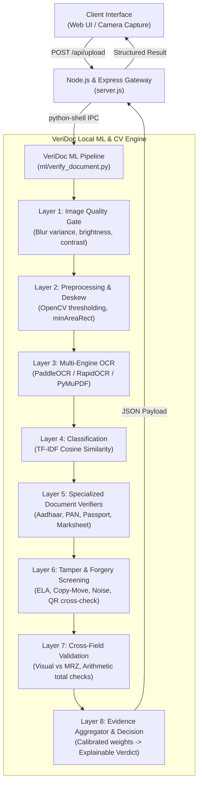

# VeriDoc: Automated Multi-Document Verification and Tamper Detection System

**MCA Mini Project | Course Code: CAF 7104**  
*A Full-Stack, Local-First Document Fraud Detection & Verification Platform*

---

## Executive Overview

**VeriDoc** is an automated, on-device document fraud detection and verification system engineered using **Node.js**, **Express**, and an offline **Python Computer Vision / Machine Learning engine** (PaddleOCR, RapidOCR ONNX, Tesseract, and OpenCV). 

Traditional document verification services rely on third-party cloud APIs that compromise sensitive Personally Identifiable Information (PII). VeriDoc eliminates cloud exposure entirely by executing all optical character recognition (OCR), structural syntax checks, image tamper analysis, and cross-field consistency evaluations locally on the host machine.

---

## Key Features

- **Multi-Engine OCR Pipeline**:
  - Primary OCR using **PaddleOCR** and **RapidOCR ONNX** for fast, high-accuracy text and tabular detection.
  - Native digital PDF text extraction via **PyMuPDF / pypdf** for lossless document parsing.
  - Fallback support for **Tesseract OCR**.
- **Deep Tamper & Forgery Screening**:
  - **Error Level Analysis (ELA)** to uncover digital splicing and re-compression artifacts.
  - **Copy-Move Forgery Detection** targeting duplicated seals, stamps, and altered text blocks.
  - **Edge Inconsistency & Noise Analysis** to detect spliced bounding boxes or localized edits.
  - **QR Code Detection & Payload Cross-Checking** to verify visual credentials against encoded QR payloads.
- **Document-Specific Verification Suite**:
  - **Aadhaar Card**: 12-digit format validation, **Verhoeff Dihedral Group ($D_8$) checksum algorithm**, single-digit OCR typo self-healing, DOB/YOB syntax, gender, and PIN code checks.
  - **PAN Card**: 10-character alphanumeric structure (`[A-Z]{5}[0-9]{4}[A-Z]`), 4th character entity type validation (Individual, Company, Trust, etc.), 5th character surname initial check, and birth date validation.
  - **Passport**: Full **ICAO Doc 9303 TD3 Machine Readable Zone (MRZ)** parsing, 7-3-1 weight modulo 10 check digit verification for passport number, date of birth, expiration date, and composite checksum, plus visual-to-MRZ text parity.
  - **Academic Marksheet**: Registration and roll number validation, subject table extraction, automated arithmetic re-calculation of aggregate marks and percentages, and grade consistency.
  - **Driving Licence & Certificates**: Serial number patterns, issue-to-expiry timeline consistency, minimum driver age validation, and issuer authority checks.
  - **Generic Documents**: TF-IDF semantic cosine similarity matching against domain templates, phone/email/date extraction, and coherence scoring.
- **Explainable Evidence & Risk Engine**:
  - Rather than outputting an opaque percentage, VeriDoc computes a multi-layer evidence graph providing transparent human-readable explanations (`VERIFIED`, `NEEDS_REVIEW`, `SUSPICIOUS`).
  - Pre-OCR Image Quality Gating (Laplacian blur variance, brightness distribution, contrast spread) ensures low-quality photos are flagged for retake rather than penalized as fraudulent.
- **Local Organization Authentication & Session Auditing**:
  - Built-in zero-cloud organization management utilizing salted `scrypt` password hashing and secure HttpOnly cookie sessions.
  - Real-time client-side session dashboard with decision breakdown, per-type metrics, and local verification history.

---

## Architecture & Verification Pipeline



---

## Supported Documents

| Document | Primary Identifiers & Format | Validation Rules |
| :--- | :--- | :--- |
| **Aadhaar Card** | 12-digit UID (`XXXX XXXX XXXX`) | Verhoeff $D_8$ dihedral checksum, single-digit error suggestion, DOB/YOB logic, gender verification |
| **PAN Card** | 10-char alphanumeric (`ABCDE1234F`) | 4th char entity check (P/C/H/F/A/T/B/L/J/G), 5th char surname match, date of birth |
| **Passport** | 8-9 char alphanumeric + 2-line MRZ | ICAO Doc 9303 TD3 MRZ check digits (7-3-1 mod 10), dates logic, visual text cross-check |
| **Marksheet** | Roll No., Subject rows, Totals | Subject marks extraction, mathematical sum verification, percentage accuracy, grading coherence |
| **Driving Licence** | State code + RTO + Year + Serial | State code validation, 18+ age requirement, issue/expiry chronological order |
| **Certificate** | Certificate No., Awardee, Issuer | Template keyword coverage, date sanity, entity completeness |
| **Generic Document** | Any standard document | TF-IDF vocabulary alignment, email/phone/date formats, structural coherence |

---

## Repository Structure

```
├── server.js                          # Express.js HTTP backend and Python process supervisor
├── package.json                       # Node.js project manifest and dependency definitions
├── README.md                          # Technical system documentation (CAF 7104)
├── data/
│   ├── users.json                     # Local organization credentials (scrypt-hashed)
│   └── sessions.json                  # Active local session tokens
├── public/                            # VeriDoc Web Frontend
│   ├── index.html                     # Responsive UI layout and upload dropzone
│   ├── styles.css                     # Design tokens, responsive grid, visual badges
│   ├── app.js                         # Dropzone, camera streaming, and verification caller
│   ├── auth.js                        # Organization authentication controller
│   └── dashboard.js                   # Browser-local verification analytics and chart renderer
├── ml/                                # Python Machine Learning & Computer Vision Core
│   ├── verify_document.py             # Main verification orchestrator CLI
│   ├── check_engines.py               # OCR engine diagnostic probe
│   ├── classifier.py                  # Probabilistic document classifier (TF-IDF)
│   ├── doc_templates.py               # Ground-truth keyword definitions & regex anchors
│   ├── verifiers.py                   # Specialized verification adapters per document type
│   ├── cross_field.py                 # Cross-field consistency (MRZ, dates, marks arithmetic)
│   ├── tamper.py                      # Computer vision tamper detection (ELA, copy-move, QR)
│   ├── image_quality.py               # Pre-OCR blur, luminance, and contrast gates
│   ├── number_checks.py               # ID pattern entropy and fabrication screening
│   ├── evidence.py                    # Calibrated evidence aggregator and verdict logic
│   ├── requirements.txt               # Full Python dependency specifications
│   └── config/
│       └── documentVerification.json  # Tunable thresholds, weights, and scoring parameters
├── tests/
│   └── test_pipeline.py               # 36 automated unit tests with synthetic datasets
├── sample/                            # Synthetic sample documents for testing
└── uploads/                           # Ephemeral upload storage (automatically purged)
```

---

## Prerequisites & Installation

### 1. Prerequisites
- **Node.js**: `v18.x` or `v20.x` LTS
- **Python**: `3.11.x` (recommended)
- **Tesseract OCR** (Optional, for fallback photo OCR):
  - **Windows**: Download installer from UB-Mannheim and ensure `tesseract.exe` is added to your system `PATH`.
  - **Ubuntu / Debian**: `sudo apt install tesseract-ocr`
  - **macOS**: `brew install tesseract`

### 2. Backend Setup
Clone or navigate to the repository directory and install the Node.js dependencies:
```bash
npm install
```

### 3. Python Virtual Environment & ML Engine Setup
Create a Python 3.11 virtual environment in the `ml/` directory and install the dependencies:
```bash
# Navigate to repository root
python -m venv ml/venv

# Activate virtual environment
# Windows (PowerShell):
ml\venv\Scripts\Activate.ps1
# Windows (cmd):
ml\venv\Scripts\activate.bat
# Linux / macOS:
source ml/venv/bin/activate

# Install required packages
pip install --upgrade pip
pip install -r ml/requirements.txt
```

Verify your OCR engine setup at any time by running:
```bash
python ml/check_engines.py
```

---

## Running the Application

### Start the VeriDoc Server
```bash
npm start
```
By default, the server initializes on **port 3000**:
```
VeriDoc running on http://localhost:3000
Make sure Python deps are installed: pip install -r ml/requirements.txt
```

### Accessing the Web Interface
Open your web browser and navigate to:
```
http://localhost:3000
```
- **Guest Verification**: Immediately drag and drop a document or use the webcam capture.
- **Organization Portal**: Create an organization profile to tag verification sessions with audit metadata.
- **Analytics Dashboard**: View real-time breakdown of verdicts (`VERIFIED`, `NEEDS_REVIEW`, `SUSPICIOUS`) stored locally in browser storage.

---

## API Reference

### 1. Document Verification Endpoint
- **URL**: `/api/upload`
- **Method**: `POST`
- **Content-Type**: `multipart/form-data`
- **Payload**:
  - `document` (File, required): Image (`.jpg`, `.jpeg`, `.png`) or PDF (`.pdf`), max 10 MB.
  - `documentType` (String, optional): `auto` (default), `aadhaar`, `pan`, `passport`, `driving_licence`, `marksheet`, `certificate`, or `generic`.
- **Response** (`200 OK`):
```json
{
  "documentType": "aadhaar",
  "documentLabel": "Aadhaar Card",
  "verdict": "VERIFIED",
  "decision": "VERIFIED",
  "overallScore": 0.91,
  "ocrConfidence": 0.94,
  "syntaxScore": 0.88,
  "semanticScore": 0.85,
  "engine": "paddleocr",
  "reasons": [
    "Valid Aadhaar 12-digit number with passing Verhoeff checksum.",
    "Cross-field checks consistent (DOB, Gender, PIN)."
  ],
  "checks": [
    {
      "check": "syntax:aadhaar:number",
      "status": "pass",
      "message": "Valid 12-digit Aadhaar number with valid Verhoeff checksum",
      "value": "2345 6789 0123"
    }
  ],
  "image_quality": { "status": "PASS", "overall": 0.92 },
  "tamper": { "status": "PASS", "flags": [] }
}
```

### 2. Health & OCR Diagnostic Check
- **URL**: `/api/health`
- **Method**: `GET`
- **Response** (`200 OK`):
```json
{
  "status": "ok",
  "service": "veridoc-system",
  "engines": {
    "paddleocr": true,
    "rapidocr": true,
    "pytesseract_lib": true,
    "tesseract_binary": true,
    "pymupdf": true,
    "pypdf": true,
    "opencv": true,
    "sklearn": true,
    "image_ocr_ready": true,
    "pdf_text_ready": true
  }
}
```

### 3. Supported Document Types
- **URL**: `/api/doc-types`
- **Method**: `GET`
- **Response**: List of acceptable template keys (`aadhaar`, `pan`, `passport`, etc.).

---

## CLI & Direct ML Execution

You can run the VeriDoc verification pipeline directly from the command line for headless batch jobs or terminal verification:

```bash
# Syntax: python ml/verify_document.py <path_to_file> <document_type>
ml\venv\Scripts\python.exe ml/verify_document.py sample/sample_aadhaar.pdf auto
```
The script will output a single structured JSON response containing the full multi-layer verification results.

---

## Automated Testing

VeriDoc includes an automated unit test suite covering the classification engine, checksum validation algorithms, MRZ parsing, arithmetic calculations, and fabrication heuristics. **All tests utilize mathematically generated synthetic test fixtures (strictly zero PII).**

To execute the test suite:
```bash
# Using the local virtual environment Python:
ml\venv\Scripts\python.exe -m unittest discover -s tests -v
```

Expected result:
```
Ran 36 tests in ~8.5s
OK
```

---

## Project Information

- **Project Title**: VeriDoc — Automated Multi-Document Verification and Tamper Detection System
- **Curriculum**: Master of Computer Applications (MCA) Mini Project
- **Course Code**: CAF 7104
- **Core Domains**: Computer Vision, Optical Character Recognition, Pattern Recognition, Algorithmic Fraud Detection, Full-Stack Local Web Systems
